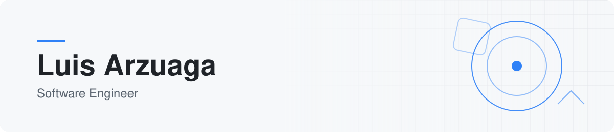
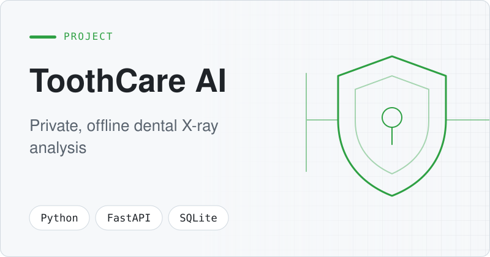
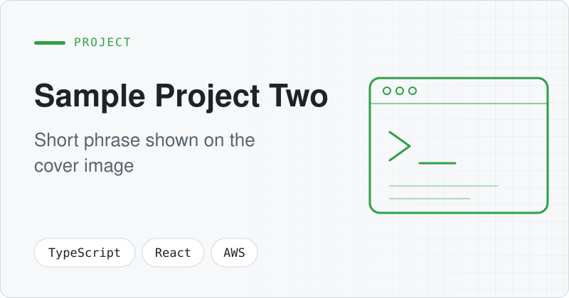

<!--
  ⚠️ This file is generated. Do not edit README.md directly.
  Edit profile.yml / projects.yml instead — see HOW_TO_UPDATE.md.
-->

<picture>
  <source media="(prefers-color-scheme: dark)" srcset="assets/banner-dark.svg">
  
</picture>

&nbsp;&nbsp;&nbsp;

## 👋 About me

- 🛡️ **Cybersecurity engineer with a developer's toolkit**: I build the software that secures, monitors and automates systems
- ⚙️ **Security automation**: turning manual security checks and workflows into reliable scripts and pipelines
- 📋 **Compliance and GRC**: automating evidence collection and control checks so compliance is continuous, not a yearly scramble
- ☁️ **Cloud security**: secure-by-default infrastructure, identity and access, and hardened Linux and Windows environments
- 🔒 **Privacy by design**: my ToothCare AI app runs fully offline so patient data never leaves the machine

## 🚀 Featured projects

<table>
  <tr>
    <td width="50%" valign="top">
      <a href="https://github.com/larzuaga11/ToothCare-AI"><picture>
        <source media="(prefers-color-scheme: dark)" srcset="assets/projects/covers/toothcare-ai-dark.svg">
        
      </picture></a>
      <h3><a href="https://github.com/larzuaga11/ToothCare-AI">ToothCare AI</a></h3>
      
Offline desktop app that analyzes panoramic dental X-rays with YOLOv11 and Faster R-CNN, detects 32 conditions and exports PDF reports. No data ever leaves the machine.

      
         

      
<a href="https://github.com/larzuaga11/ToothCare-AI"><b>Code</b></a>

    </td>
    <td width="50%" valign="top">
      <a href="https://github.com/larzuaga11/sample-project-two"><picture>
        <source media="(prefers-color-scheme: dark)" srcset="assets/projects/covers/sample-project-two-dark.svg">
        
      </picture></a>
      <h3><a href="https://github.com/larzuaga11/sample-project-two">Sample Project Two</a></h3>
      
Replace with a one-line summary of the problem and the outcome

      
   

      
<a href="https://github.com/larzuaga11/sample-project-two"><b>Code</b></a>

    </td>
  </tr>
</table>

## 🛠️ Tech stack

**Languages** 
      

**Infrastructure & OS** 
    

**Frameworks & AI** 
      

**Databases & Tools** 
   

## 📊 GitHub stats

<picture>
  <source media="(prefers-color-scheme: dark)" srcset="https://github-readme-stats.vercel.app/api?username=larzuaga11&show_icons=true&hide_border=true&bg_color=00000000&title_color=2EA043&icon_color=2EA043&text_color=E6EDF3">
  
</picture>
<picture>
  <source media="(prefers-color-scheme: dark)" srcset="https://github-readme-stats.vercel.app/api/top-langs/?username=larzuaga11&layout=compact&langs_count=8&hide_border=true&bg_color=00000000&title_color=2EA043&text_color=E6EDF3">
  
</picture>

<picture>
  <source media="(prefers-color-scheme: dark)" srcset="https://streak-stats.demolab.com?user=larzuaga11&theme=dark&hide_border=true&background=00000000&ring=2EA043&fire=2EA043&currStreakLabel=2EA043">
  
</picture>

---

Profile auto-generated from <code>profile.yml</code> and <code>projects.yml</code> · last built 2026-10-21

